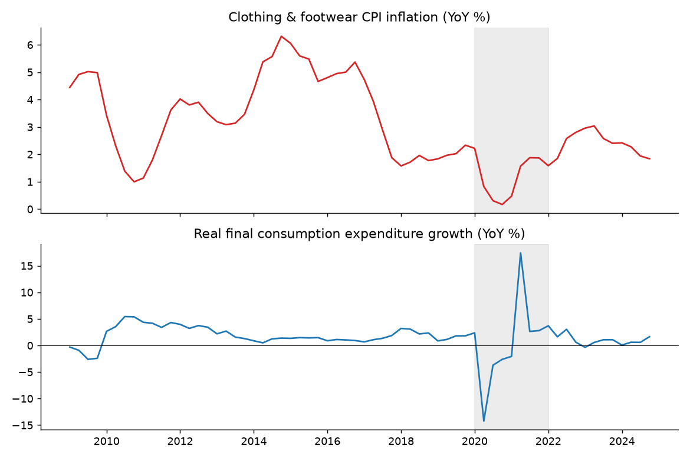
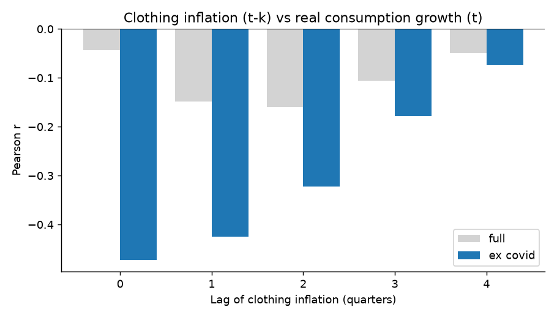

# Clothing & Footwear Price Pressure and Household Consumption in South Africa (2008–2024)

**Research question:** *As clothing and footwear prices have risen in South Africa, has real consumption kept pace, stalled or declined, how much of the apparent growth in spending is just inflation, and what does the trend imply for the sector going forward?*

An end-to-end analysis (validated ingestion → transformation → statistical testing → forecasting → optional PostgreSQL layer) built on open FRED/IMF/OECD data. Written for two audiences: economists (identification, robustness, limitations) and data teams (reproducible, tested, documented pipeline).

## Data

| Series | FRED ID | Frequency | Notes |
|---|---|---|---|
| CPI: clothing & footwear (index) | `ZAFCP030000IXOBQ` | Quarterly, 2008Q1–2024Q4 | OECD; index level, YoY growth derived |
| Real final consumption expenditure | `NCRNSAXDCZAQ` | Quarterly, 1993Q1–2026Q1 | IMF IFS; millions of rand, constant prices, **not seasonally adjusted** |
| Nominal final consumption expenditure | `NCNSAXDCZAQ` | Quarterly | IMF IFS; same basis as the real series; used to recover the deflator |

The analysis window is set by the CPI series (2008Q1–2024Q4, 68 quarters). Real consumption is *total* final consumption, so this is a study of aggregate consumer resilience with clothing prices as one indicator of price pressure, not a clothing-demand elasticity.

## Method

1. **Extract and validate.** Delimiter auto-detection, type coercion, and hard assertions for duplicate dates, missing values and gaps in the quarterly index.
2. **Transform.** Both series are not seasonally adjusted, so year-on-year growth (4-quarter change) is used to remove the seasonal cycle. COVID-19 (2020Q1–2021Q4) is flagged because lockdown and rebound base effects dominate the variance.
3. **Deflation.** The implicit consumption deflator is nominal ÷ real × 100. Nominal growth is decomposed into real growth plus price growth over full calendar years (avoids seasonal bias from comparing different quarters). Clothing inflation is compared with this broad measure, and the clothing price relative to the general price level is tracked.
4. **Lead–lag analysis.** Pearson correlations for lags 0–4 quarters, full sample versus ex-COVID; ADF stationarity tests; robustness in first differences and on the pre-COVID sample.
5. **Regression.** Real consumption growth on lagged clothing inflation, OLS with Newey–West (HAC) standard errors, estimated on a common sample so AIC is comparable across lags.
6. **Outlook.** AR(1) forecast of clothing inflation with an 80% interval (illustrative only).

## Results

<!-- RESULTS:START -->
**Sample.** 68 quarters, 2008Q1 to 2024Q4 (64 with year-on-year growth rates).

**Clothing & footwear inflation** averaged 3.0% a year (median 2.7%), ranging from 0.2% (2020Q4) to 6.3% (2014Q4). The last four quarters averaged 2.1%, versus 3.0% over the full sample.

**Real consumption growth** averaged 1.6% a year (std. dev. 3.4 pp). Its weakest quarter was 2020Q2 (-14.2%) and its strongest 2021Q2 (17.4%), both inside the COVID-19 window.

**Stationarity (ADF).** Clothing inflation is persistent (cannot reject a unit root at 5%) (p = 0.27); real consumption growth is stationary at 5% (p = 0.014). Persistent series can produce spurious correlations, so the robustness checks below also use first differences.

**Lead-lag relationship.** Excluding COVID-19, the strongest correlation between clothing inflation and real consumption growth is r = -0.47 at a lag of 0 quarter(s) (n = 56), statistically significant (p < 0.001). On the full sample the same lag gives r = -0.04 (not statistically significant (p = 0.73)). Contemporaneous correlation ex-COVID: r = -0.47.

**Robustness (contemporaneous, ex-COVID).** In first differences r = -0.44 (statistically significant (p < 0.001), n = 55); pre-COVID only (2009Q1 to 2019Q4) r = -0.59 (statistically significant (p < 0.001), n = 44).

**Regression (HAC errors, COVID window excluded, common sample).** The best-fitting lag by AIC is 0 quarter(s): a 1 pp rise in clothing inflation is associated with a -0.37 pp change in real consumption growth, statistically significant (p = 0.032), R² = 0.15. Real consumption is total, not clothing-specific, so this measures aggregate resilience, not clothing demand elasticity.

**Outlook (illustrative AR(1), 80% interval).** Clothing inflation is projected at 1.9% next quarter, 2.1% in four quarters (interval 0.9% to 3.4%), drifting towards the sample mean of 3.0%.
<!-- RESULTS:END -->

### Figures





## Interpretation

- **COVID-19 masks the underlying relationship.** On the full sample the correlation is close to zero because two extreme quarters dominate the variance. Removing the pandemic window reveals a consistent negative association (periods of higher clothing inflation coincide with weaker real consumption growth). It survives differencing and a pre-COVID-only test, so it is not an artefact of persistent series or of the pandemic.
- **Association is not causation.** A price-squeeze channel (higher prices erode real purchasing power) is one reading. A common driver is equally plausible: rand depreciation raises the cost of imported goods, including apparel, while also weakening the real income outlook. This study cannot separate the two; an instrumental-variable or exchange-rate-controlled specification is the natural next step.
- **Nominal figures overstate growth.** Comparing nominal with real consumption shows how much apparent expansion is price change rather than additional volume. This is the reason real series are the right basis for judging consumer resilience.
- **Clothing versus the headline.** Comparing clothing inflation with the consumption deflator shows whether apparel is driving the cost-of-living squeeze or lagging it (see the relative-price figure and results above).
- **Outlook.** The AR(1) projection is a statistical baseline that mean-reverts quickly; it does not model the rand, import tariffs, or retail-sector shocks and should not be read as a forecast of spending.

## Limitations

- Total, not clothing-specific, consumption; household and government spending are combined in final consumption.
- Both series are NSA; YoY growth handles seasonality but introduces serial correlation (hence HAC errors and difference checks).
- CPI is a national index; it does not capture second-hand/informal markets or substitution towards cheaper outlets.
- About 56 usable ex-COVID observations: results indicate association and have limited power for lag selection.
- The forecast is a univariate baseline.

## Reproduce

```bash
pip install -r requirements.txt
# place the three FRED CSVs in data/raw/ (filenames in analysis.py)
python analysis.py                  # cleans, analyses, writes figures, tables and the Results block above
python load_to_postgres.py          # optional: needs DATABASE_URL (see script); runs queries.sql
```

## Repository layout

```
analysis.py            pipeline: validate → transform → analyse → chart → write findings
load_to_postgres.py    optional PostgreSQL load + query runner
queries.sql            window functions, CTE, ranking (PostgreSQL)
data/raw, data/processed   source CSVs and merged panel
outputs/               figures, tables, findings.md
```

## Tech
Python (pandas, NumPy, SciPy, statsmodels, matplotlib), PostgreSQL/SQL (window functions, CTEs), Git/GitHub.

*Author: Don · Data: FRED (Federal Reserve Bank of St. Louis), sourced from the OECD and IMF International Financial Statistics.*
